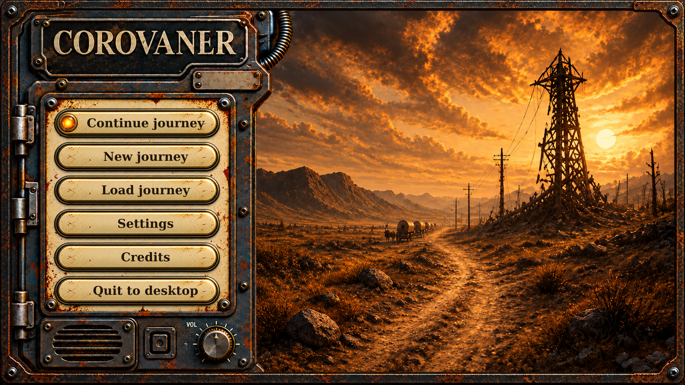

# Corovaner terminal — separate paintings

The creator selected the terminal reference and requested independent artwork
for the metal rim, caravan painting and hinged enamel panel. The panel keeps the
COROVANER title; its tagline area and small riveted plate are blank for custom
labels. The main menu now uses these independent layers and controls in Scene2D.
See [runtime behavior and checks](../../../docs/menus/README.md#terminal-main-menu).

## Separate assets

| Asset | Dimensions | Use |
| --- | --- | --- |
| [Caravan painting](layers/01-caravan-painting.png) | 1920 × 1080 | Opaque rectangular background; replace with the artist's painting later. |
| [Hinged enamel panel](layers/02-hinged-panel.png) | 1920 × 1080 | Transparent outside the panel, empty enamel area and two blank label areas. |
| [Outer metal rim](layers/03-metal-rim.png) | 1920 × 1080 | Transparent center; separate perimeter frame. |
| [Enamel button](controls/button-enamel.png) | 478 × 100 | Text-free button with shadow; example placement box is 480 × 100. |
| [Round hover lamp](controls/lamp-hover.png) | 70 × 70 | Separate amber lamp and halo; display on hover or keyboard focus. |

Draw the three full-canvas layers in the table's order at `(0, 0)`, then add
buttons and live labels. Only the first button's lamp is lit in the example.

## Editing and placement

- [Layered OpenRaster document](Corovaner-Terminal-1920x1080.ora): three independent
  paintings, suitable for an editor supporting ORA.
- [Empty assembled preview](assembly-empty.png): panel without buttons.
- [Editable composition](assembly-buttons.svg): separate image references and
  editable example text. Download the folder together to resolve its images.
- [Placement coordinates](layout.json): canvas and button positions, top-left origin.
- [Integration and source notes](README.txt), [validation](VALIDATION.txt), and
  [generation prompts](source/generation-prompts.json).

The main layers were reconstructed from the selected reference using built-in
image generation. Native outputs are 1672 × 941; delivery exports are exactly
1920 × 1080. The [native sources](source/) are preserved for further art work.
This pack does not establish a gameplay map reference: the main map remains
full-display 3D, independent of this menu composition.
