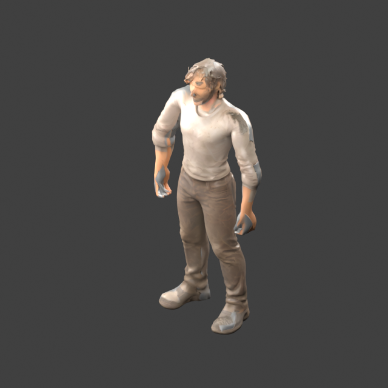
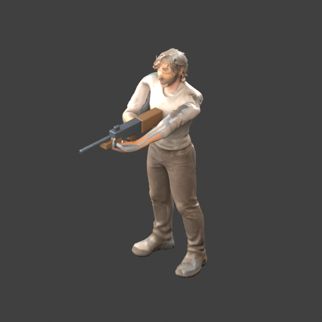
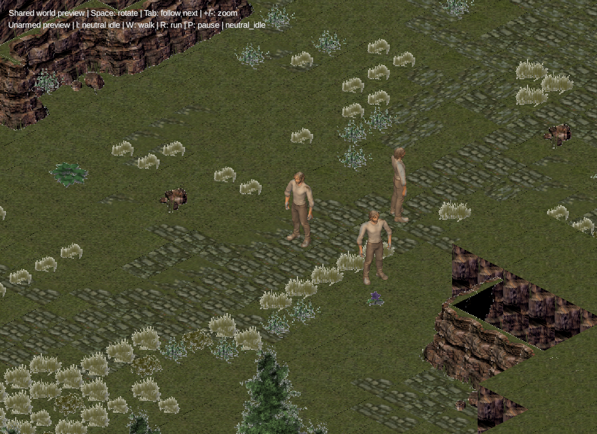

# Animated protagonist

The accepted `maleprot_lowpoly_balanced_2k.blend` remains unchanged. The new
[rig master](maleprot_rig_master.blend) is an editable, keyed Blender armature.
The game asset is [protagonist.glb](../../../assets/models/protagonist/protagonist.glb).

The IDE character preview now opens in a neutral, unarmed stance with arms at
the sides. All preview actors hide the rifle on their own model instances.
The game's weapon-ready clips and shared asset remain available.





## Delivered rig

- 22 bones, including a ground-level root; **no finger bones or finger animation**.
- Whole hands have a fixed curled grip. Arms, wrists, torso and legs animate.
- Body: 4,935 stored vertices and 9,998 triangles; no boundary or non-manifold edges.
- A 264-triangle rifle fitting fixture follows `hand_r`. It is a separate mesh,
  `Equipment_Rifle`, and can be removed or replaced independently of the body.
- One body material with three packed 2K textures; the fixture has two simple
  materials. Runtime conversion uses the existing world shader rather than a
  separate character renderer. It uses matte diffuse lighting; normal and
  metallic/roughness maps stay in the GLB but full PBR rendering is not enabled.
- Maximum four normalized skin influences per body vertex, one for equipment.
- Height 2.2 world units, Y-up and +Z forward in the game; Blender remains Z-up,
  facing -Y. Foot grounding and torso-centered placement are baked into the mesh.

This intentionally uses a small FK skeleton with editable keyframes. It does
not require Rigify and does not include an IK control rig. The user's simplified
movement and fixed-hand requirement does not need the more elaborate authoring
rig discussed during planning.

## Clips and equipment contract

| Clip | Duration | Purpose |
| --- | --- | --- |
| `idle` | 2 seconds | Subtle breathing in the weapon-ready stance |
| `walk` | 16/30 seconds | In-place locomotion, reference speed 1.76771955 units/s |
| `run` | 12/30 seconds | Faster stylized gait, reference speed 3.53543910 units/s |
| `rig_test` | 1 second | Raised arms, squat and torso turn for deformation review |
| `neutral_idle` | 2 seconds | Default preview stance, relaxed arms and empty hands |
| `neutral_walk` | 16/30 seconds | Preview walk with relaxed arm swing |
| `neutral_run` | 12/30 seconds | Preview faster gait with relaxed arm swing |

Clips start at time zero and return to their initial pose. Runtime movement and
collision own displacement; playback speed follows resolved movement. The `run`
clip has no flight phase. Attacks, reloads, facial animation and advanced hand
movement are outside this delivery.

Stable hierarchy:

```text
root
  hips
    spine -> chest -> neck -> head
                    clavicle_l/r -> upper_arm_l/r -> forearm_l/r -> hand_l/r
    thigh_l/r -> shin_l/r -> foot_l/r -> toe_l/r
```

Keep these names, hierarchy and rest transforms stable when reusing clips or
skinning clothing. New proportions require retargeting and deformation review.
The fixed hands are fitted to this stance; another weapon requires grip-offset
and support-hand fitting, not just a different mesh path.

| Exported socket | Parent | Intended use |
| --- | --- | --- |
| `socket_weapon_r` | `hand_r` | Primary weapon grip |
| `socket_support_l` | `hand_l` | Support contact/reference |
| `socket_back` | `chest` | Carried equipment |
| `socket_head` | `head` | Headwear reference |

The rifle is currently skinned rigidly to the hand so it shares animation and
resource ownership. Sockets are retained for later equipment instances; do not
attach the existing fixture a second time. Collision remains independent of
the skin. Future modular outfits need deliberate boundaries and covered-body
masking; this clothed mesh is not a complete interchangeable wardrobe.

## Reproduce and validate

Find the installed Blender executable (`Get-Command blender`, or inspect the
Blender Foundation installation directory) and assign it to `$blenderExe`.
Run from the repository root:

```powershell
& $blenderExe --background --disable-autoexec --python-exit-code 1 --python tools/protagonist_pipeline.py -- baseline
& $blenderExe --background --disable-autoexec --python-exit-code 1 --python tools/protagonist_pipeline.py -- build
& $blenderExe --background --disable-autoexec --python-exit-code 1 --python tools/validate_protagonist.py
& $blenderExe --background --disable-autoexec --python-exit-code 1 --python tools/protagonist_review.py
```

The build refuses to overwrite an existing master/export unless explicitly
passed `--replace-generated`. Preserve manual animation or weight edits in a
separate file before regenerating. `--skip-renders` skips review images, not
asset generation. The accepted source is never saved over.

The builder removes two independently identified pre-existing sliver faces,
preserving other face-corner UVs, then shapes the hands, binds the mesh and
authors clips. It explicitly recalculates normals after shaping. Runtime GLB
export bakes the bone animation and includes a retained root and sockets.

[Validation results](rig_review/validation.json) record source/export SHA-256,
stored and exported geometry, topology, skin normalization, every authored-frame
bounds, clip endpoints, reload geometry, and sampled animated/socket equivalence.
Reloaded animation surface error is below 0.00001 world units at the tested
phases. UV seams increase exported vertex count without adding triangles.

## Review evidence

| Stage | Independent review and result |
| --- | --- |
| Baseline | Confirmed torso centerline, palm orientation and the two exact topology repairs |
| Rig and fixed grip | Rejected initial collapsed wrists; accepted corrected forearm roll and smoothly weighted wrists |
| Deformation | Accepted raised arms, squat, turn and sampled alternating stance/swing poses for the gameplay camera |
| Export and reuse | Independently compared 19 reloaded poses, socket matrices, UVs and texture roles; passed |
| Runtime | 32 tests and both real-GL desktop smoke tasks pass; excessive Phong highlights and flipped captures fixed after visual review |

Representative views:

- [Baseline front](rig_review/baseline_front.png), [baseline top](rig_review/baseline_top.png).
- [Grip with equipment](rig_review/grip_iso.png), [clay grip](rig_review/clay_grip_iso.png),
  [clay underside](rig_review/clay_grip_underside.png).
- [Squat side](rig_review/clay_bend_side.png), [torso turn](rig_review/turn_iso.png).
- [Walk stance](rig_review/walk_01_side.png), [walk swing](rig_review/walk_side.png).
- [Measured rest overlay](rig_review/overlay_rest_front.png),
  [posed overlay](rig_review/overlay_idle_iso.png), and
  [fitted-joint measurements](rig_review/overlay_measurements.json).
- [Dark clay grip](rig_review/overlay_clay_grip_iso.png).

Overlay endpoints are fitted rig landmarks, not reconstructed anatomy or actual
fingertip locations. Green is anatomical left, magenta right, and the dashed amber
chain mirrors the left about the recentered torso plane for comparison.

Known visual limits: angular finger webs at close range, some knee-volume loss
in the deepest diagnostic squat, and limited foot roll. These are accepted for
the current distant camera and basic movement requirement, not cinematic use.
No lower LOD or smaller textures were introduced without a measured need.

## Runtime verification and preview

Added dependency: `com.github.mgsx-dev.gdx-gltf:gltf:2.2.1` in `core`.
The existing central AssetManager owns the SceneAsset, model and textures.
Each actor owns its animation controller. The existing world camera, ModelBatch
and uninterrupted depth buffer render map, actors and equipment together.

Verified on this desktop:

```powershell
.\gradlew.bat test lwjgl3:characterSmoke lwjgl3:characterApplicationSmoke build --console=plain
```

All 32 core tests passed with zero failures/errors. The first hidden desktop
smoke loads the real GLB and map, renders idle/walk/run through WorldScene,
checks animated sockets and paused-world playback, and checks OpenGL errors.
The second runs Main's real startup queue and CharacterPreviewScreen, including
screen hide/show, application pause/resume, resize and 60 preview frames.

[World smoke result](rig_review/runtime_world_result.txt) ·
[Application smoke result](rig_review/runtime_application_result.txt) ·
[Idle close-up](rig_review/runtime_idle.png) ·
[Walk](rig_review/runtime_walk.png) · [Run](rig_review/runtime_run.png)



Launch the interactive preview with `.\gradlew.bat lwjgl3:previewCharacter`.
`I` selects neutral idle, `W` unarmed walk, `R` unarmed run, and `P` pauses the followed actor's playback.
`Tab` follows the next actor, `Space` toggles rotation, and `+/-` zooms.
Normal gameplay uses WASD/click navigation and Shift for faster movement.

## Pipeline references

- [Blender skinning and automatic weights](https://docs.blender.org/manual/en/latest/animation/armatures/skinning/parenting.html)
- [Blender glTF animation and skin export](https://docs.blender.org/manual/en/latest/addons/scene_gltf2.html)
- [gdx-gltf loaders, material conversion and shader limits](https://github.com/mgsx-dev/gdx-gltf)
- [libGDX animation controllers](https://libgdx.com/wiki/graphics/3d/3d-animations-and-skinning)

Follow [the modelling guide](../../modelling.md) when revising the source and
[world architecture](../architecture.md) when extending runtime behavior.
