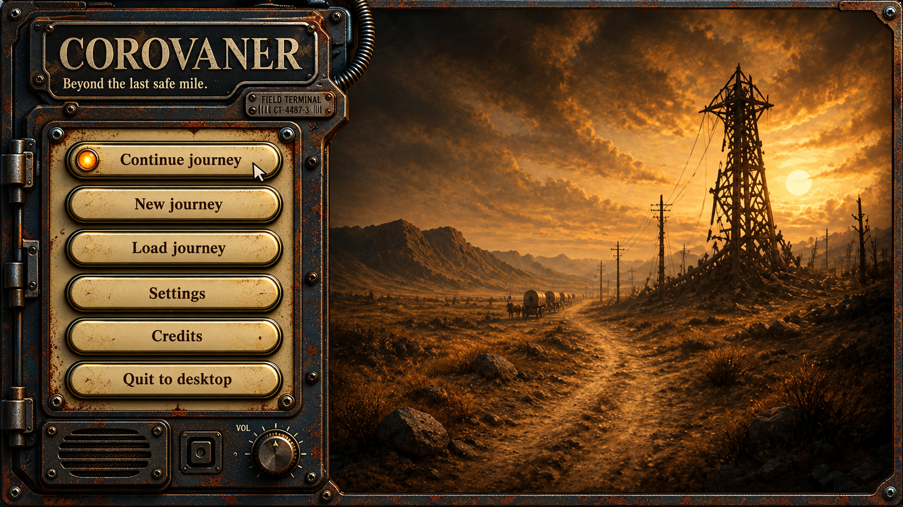
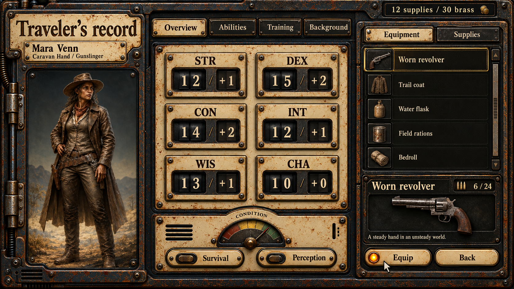
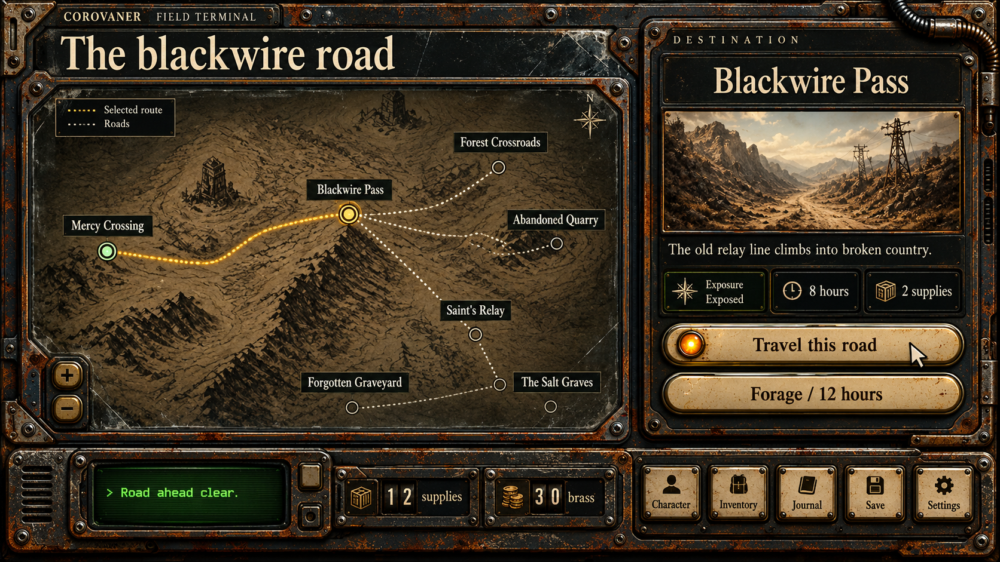

# Coffee-enamel UI material studies

**Proposal / development reference.** Exported from the UI concept iteration;
recorded in this branch on 2026-10-25. The creator requested coffee-colored metal
buttons matching `assets/MainModal.png`, more varied UI hardware, and a round
amber lamp on the hovered action. See [the direction and display rules](../../ui-art-direction.md).

The later display decision targets a centered 1920 x 1080 composition with
painted side margins on wider displays and uniform downscaling on smaller ones.
The main-menu picture stays rectangular. These earlier concept exports have not
been reformatted into production artwork for that canvas.

| Image | Qualities to study | Not established by this image |
| --- | --- | --- |
| [Main menu](corovaner-main-menu.png) | Rounded enamel metal buttons, worn steel housing, separate lamp, grille and dial. | Final menu footprint, typography, setting details or approved production artwork. |
| [Character record](corovaner-character.png) | Recessed counters, inventory wells, tabs, gauge and distinct utility controls. | Character identity, statistics, rules, equipment balance or final screen layout. |
| [Travel material study](corovaner-travel.png) | Enamel action buttons, small utility keys, resource counter forms, recessed log display. | Map art, travel layout, route graph, camera, interactions or a quality target. |

The travel image retains an earlier composition from the material study. The
creator rejected the old map and travel interface as design references; do not
use this image to bring those layouts or interactions back as requirements.
The map and travel experience need their own work derived from the main vision.

These are generated raster concept images, 1672 x 941. Embedded words and values
are illustrative. Runtime assets and live labels are separate in the
[component kit](../../../../assets/ui-architecture/coffee-enamel/README.txt).
`PROMPTS.txt` records the generation brief. Original material source:
[MainModal.png](../../../../assets/MainModal.png).

