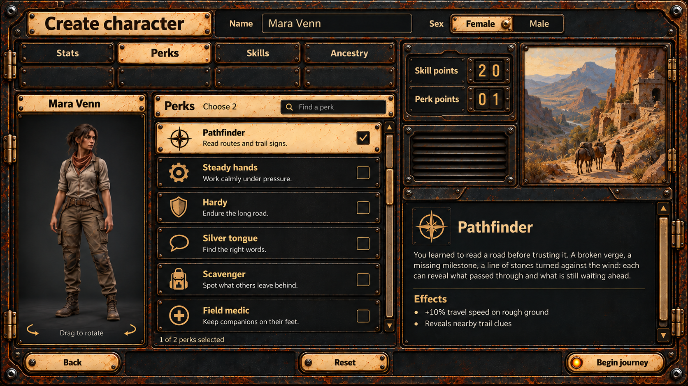
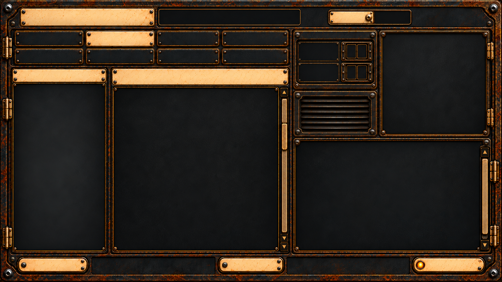
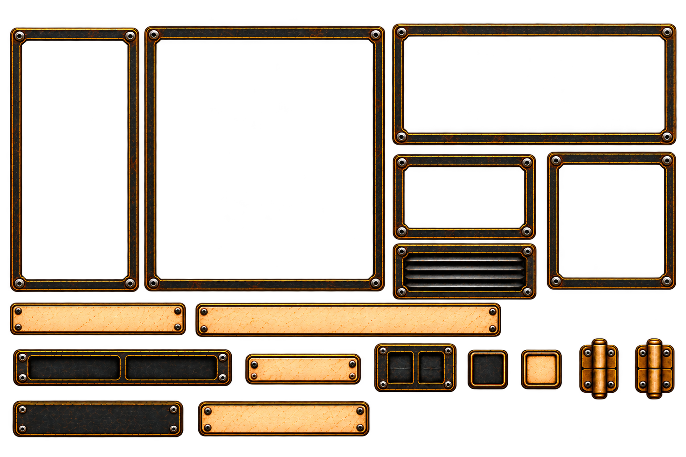
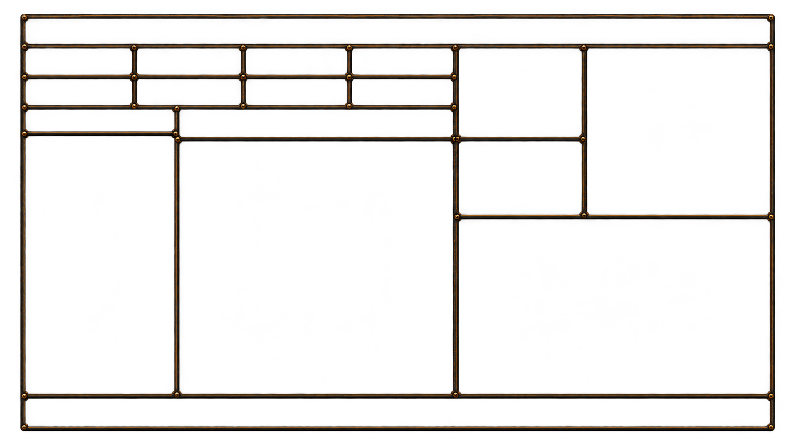

# Coffee-enamel character creation

**Concept art and component studies.** Created during the 2026-10-26 design
iteration and preserved here at the creator's requested path. These files extend
the [UI art direction](../../../design/ui-art-direction.md).

## Images

| File | Native size | Purpose |
| --- | --- | --- |
| [Populated concept](character-creation-concept.png) | 1672 × 941, RGB | Selected composition, example content, character preview and artwork placement. |
| [Component sheet](character-creation-components.png) | 1536 × 1024, RGBA | Seventeen blank hardware studies: five surrounds, vent, selector housing and insert, counter housing, two checkbox surfaces, two brass hinges, two enamel headers and two category-button states. |
| [Thin inner rim](character-creation-inner-rim.png) | 1671 × 941, RGBA | Separate table-like mounting frame with eighteen openings for the header, footer and content sections. |
| [Empty assembly](character-creation-empty-assembly.png) | 1672 × 941, RGB | Latest generated visual assembly with straight panel edges and blank content areas. |

The component sheet and inner rim contain transparent pixels and transparent
frame openings. PNG bytes are preserved from the original generated images.
The populated concept predates the final removal of panel dents; the component
sheet and empty assembly carry the later straight-edge direction.

## Creator-selected direction

- Design around a centered **1920 × 1080** reference composition, following the
  existing uniform-scaling rules. The native image dimensions above remain
  unchanged; these are not 1920 × 1080 production exports.
- Keep distinct full-width header and footer areas inside `03-metal-rim`.
  Put the name field and sex switch in the header.
- On the left, place two rows of four buttons above the character and middle
  content panels. The first row switches Stats, Perks, Skills and Ancestry in
  the middle panel; the second row remains blank for later use.
- Give the persistent character preview and middle content panel separate
  blank enamel header plates. Perks use checkboxes without a Select perk button;
  the Appearance button and the old stat summary above the preview are removed.
- On the right, place points above a vent, with an artwork opening beside them.
  Anchor the description window below this module, using approximately half
  the right content area's height. Omit the Description label.
- Use straight panel rails without dents, notches or raised top ornaments.
  Match the upper-right panel's dark steel and brass finish, retaining separate
  brass side hinges and dark/enamel category-button states.
- Keep labels live: **Manrope**, amber `#D5A451` on dark surfaces and espresso
  `#21160B` on enamel. Generated lettering is only a visual approximation.

## Scope and validation

Names, statistics, point values, perks, ancestry, effects and the inset painting
in the populated image are illustrative. They do not establish game rules or
a gameplay-map reference. The blank component studies omit that content.

The assembly is a generated visual fit study, not a deterministic composition
of extracted sprites or an in-game screenshot. The sheets are not registered
pixel-for-pixel with one another. Sprite bounds, common-scale normalization,
alpha-edge cleanup, padding and atlas metadata still need production work.

For this import, all four PNGs were decoded successfully and their copied bytes
checked against their sources. No runtime files or loaders are changed. Approved
production assets belong in the flat [runtime UI folder](../../../../assets/ui/Menus/README.md).

